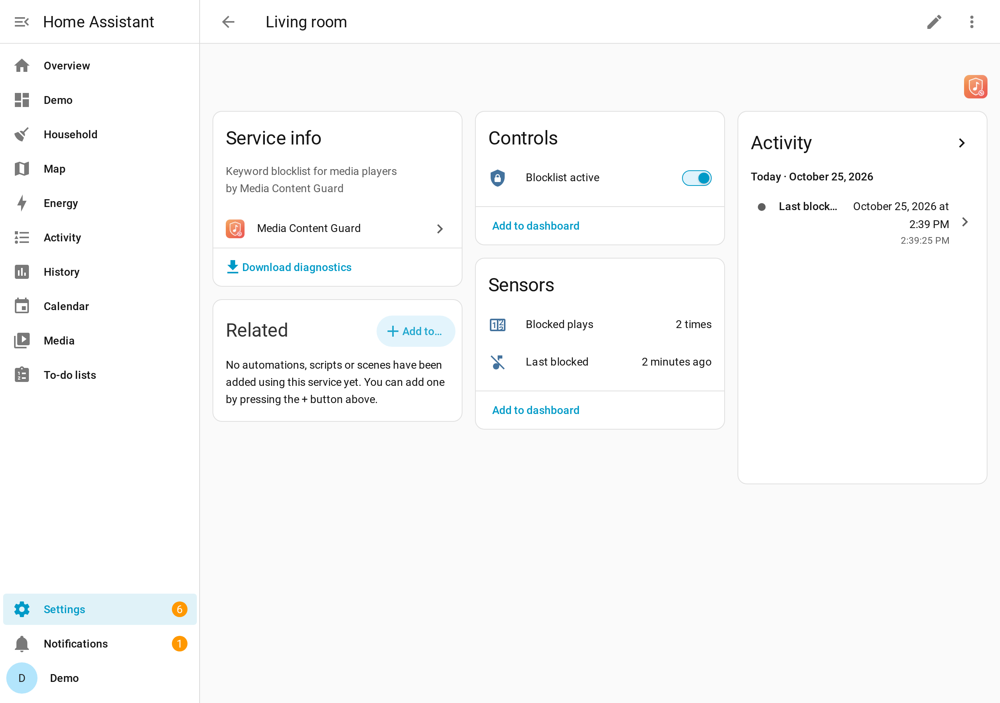

> 🇬🇧 [English](README.md) · 🇩🇪 Deutsch (diese Seite)

<p align="center">
  
</p>

<h1 align="center">Media Content Guard</h1>

<p align="center">
  <b>Eine Stichwort-Sperrliste für deine Home-Assistant-Media-Player: Sobald ein Lautsprecher etwas von der Liste abspielt, wird die Wiedergabe gestoppt – notfalls immer wieder.</b>
</p>

<p align="center">
  <a href="https://github.com/hacs/integration"></a>
  <a href="https://github.com/Jo-Highness/media_content_guard/actions/workflows/validate.yml"></a>
  <a href="https://github.com/Jo-Highness/media_content_guard/actions/workflows/test.yml"></a>
  <a href="https://github.com/Jo-Highness/media_content_guard/releases"></a>
  <a href="LICENSE"></a>
  
</p>

Typischer Einsatz: Die Hörspiele der Kinder sollen im Kinderzimmer laufen – aber **nicht** auf
der Box im Wohnzimmer. Oder: Dieses eine Lied nie wieder in der Küche. Stichwörter auf die
Liste, Lautsprecher auswählen, fertig.

## Schnellstart

1. **Installieren** über HACS: [](https://my.home-assistant.io/redirect/hacs_repository/?owner=Jo-Highness&repository=media_content_guard&category=integration) → **Herunterladen** → Home Assistant neu starten.
2. **Hinzufügen:** **Einstellungen → Geräte & Dienste → Integration hinzufügen → Media Content Guard**.
3. Der Regel einen **Namen** geben (z. B. `Wohnzimmer`), die **Lautsprecher auswählen** und die
   **Sperrliste** eintragen – ein Stichwort pro Zeile.
4. **Fertig.** Spiel etwas von der Liste auf einem der Lautsprecher ab: Es wird nach einem
   Moment gestoppt, und `sensor.content_guard_wohnzimmer_last_blocked` zeigt, was, wo und warum.

Unterschiedliche Listen für unterschiedliche Räume? Einfach eine weitere Regel anlegen
(Schritt 2–3).

## Was es kann

- 🔎 **Durchsucht Titel, Album, Interpret und Content-ID** – Groß-/Kleinschreibung egal,
  Wortteile genügen: `tkkg` sperrt „TKKG Folge 200“, `???` sperrt „Die drei ???“. Auf Wunsch
  auch Playlist, Serie, Sender, App und Quelle.
- 🔊 **Beliebig viele Lautsprecher pro Regel, beliebig viele Regeln** – ein Lautsprecher darf
  in mehreren Regeln stecken.
- ✏️ **Sperrliste in der Oberfläche** – jederzeit unter **Konfigurieren** änderbar; kein YAML,
  kein Neustart. Oder per Aktion `add_keyword` / `remove_keyword` (z. B. Dashboard-Button,
  Sprachassistent).
- 🔁 **Hartnäckig** – läuft der Inhalt weiter (Sonos-Apps versuchen es gern erneut), wird alle
  2 Sekunden erneut gestoppt und jedes Mal frisch geprüft; sobald etwas Harmloses läuft, hört
  es auf.
- 🛟 **Verpasst nichts** – geprüft wird beim Start der Wiedergabe, bei jedem Titel-/Albumwechsel,
  direkt nach dem Start von Home Assistant oder einer Listenänderung, beim Einschalten und als
  Sicherheitsnetz alle 30 Sekunden.
- 🔕 **Ein/Aus-Schalter pro Regel** – der Zustand übersteht Neustarts.
- 📒 **Logbuch-Eintrag und Ereignis** bei jedem Stopp (`media_content_guard_blocked`) – ideal
  für eine Push-Benachrichtigung.
- 🌍 **Mehrsprachig** – Deutsch, Englisch, Spanisch und Französisch.
- 🧩 **Komplett lokal** – keine Cloud, keine Abhängigkeiten.

### Was es nicht kann

Ein Komfort-Werkzeug, keine Kindersicherung:

- Es sieht nur, was der Player an Home Assistant meldet. Ohne Titel (manche Radiosender,
  AirPlay/Bluetooth vom Handy, TV-Eingang) gibt es nichts zu vergleichen.
- Es reagiert *nachdem* die Wiedergabe begonnen hat – die erste Sekunde kann zu hören sein.
- Gestoppt wird mit `media_player.media_stop` (bzw. `media_pause`, wenn der Player nicht
  stoppen kann). Ein Player, der offline ist oder den Befehl ignoriert, spielt weiter; der
  Versuch wird protokolliert und wiederholt.
- Wer Zugriff auf Home Assistant hat, kann die Regel ausschalten oder die Liste ändern.
- Stichwörter treffen Wortteile: ein sehr kurzes Stichwort (z. B. `ego`) sperrt auch „Lego“.
  Lieber eindeutige Stichwörter verwenden.

## Screenshot

> Aufgenommen in einem Demo-Home-Assistant mit erfundenen Daten.



## Installation

### HACS (empfohlen)

1. Oben auf **In HACS öffnen** klicken oder unter **HACS → ⋮ → Benutzerdefinierte Repositories**
   `https://github.com/Jo-Highness/media_content_guard` als Typ **Integration** hinzufügen.
2. Nach **Media Content Guard** suchen und **herunterladen**.
3. Home Assistant **neu starten**.

### Manuell

1. `custom_components/media_content_guard/` nach `<config>/custom_components/` kopieren.
2. Home Assistant **neu starten**.

Benötigt **Home Assistant 2025.2** oder neuer.

## Einstellungen

Einrichtung und spätere Änderungen (**Konfigurieren** an der Regel) verwenden dasselbe Formular:

| Feld | Bedeutung |
|---|---|
| **Name der Regel** | Gerätename und Ziel für die Aktionen, z. B. `Wohnzimmer`. Muss eindeutig sein. |
| **Überwachte Media-Player** | Ein oder mehrere `media_player`. |
| **Sperrliste** | Ein Stichwort pro Zeile. Groß-/Kleinschreibung egal, Wortteile genügen, leere Zeilen und Doppelte fallen weg. |
| **Diese Angaben prüfen** | Welche Medienangaben durchsucht werden. Standard: Titel, Album, Interpret, Content-ID. Optional: Playlist, Serie, Sender, App, Quelle. |

Änderungen gelten sofort – was gerade läuft, wird direkt erneut geprüft.

## Entitäten

Jede Regel bekommt ein **Gerät** mit ihrem Namen. `<regel>` ist der Name beim Anlegen in
Kleinbuchstaben mit Unterstrichen, z. B. `wohnzimmer`:

| Entität | Typ | Zweck |
|---|---|---|
| `switch.content_guard_<regel>_active` | Schalter | **Sperrliste aktiv** – aus = es wird nichts gestoppt. Attribute `players`, `keyword_count`. |
| `sensor.content_guard_<regel>_last_blocked` | Sensor (Zeitstempel) | Wann zuletzt gestoppt wurde. Attribute `player`, `matched_keyword`, `matched_field`, `media_title`, `media_artist`, `media_album_name`. |
| `sensor.content_guard_<regel>_blocked_count` | Sensor (steigend) | Wie oft diese Regel schon gestoppt hat. |

Schalterzustand, Zähler und letzte Sperre überstehen Neustarts. Beim Umbenennen der Regel
bleiben die Entitäts-IDs erhalten. Wird ein überwachter Player umbenannt oder entfernt, meldet
eine **Reparatur** welcher – diese Player sind erst wieder geschützt, wenn du unter
**Konfigurieren** die aktuellen auswählst.

## Aktionen

Beide Aktionen adressieren eine Regel, entweder über **`rule`** (Name, Groß-/Kleinschreibung
egal) oder über **`config_entry_id`** (bleibt nach Umbenennen gültig). `keyword` nimmt ein
Stichwort oder eine Liste.

| Aktion | Beschreibung |
|---|---|
| `media_content_guard.add_keyword` | Fügt Stichwörter hinzu (Doppelte werden ignoriert). Was gerade läuft, wird sofort geprüft. |
| `media_content_guard.remove_keyword` | Entfernt Stichwörter. Meldet verständlich, wenn keines davon auf der Liste steht. |

## Ereignis

Jeder Stopp löst `media_content_guard_blocked` aus, mit `entry_id`, `rule_name`, `entity_id`,
`matched_keyword`, `matched_field`, `media_title`, `media_artist`, `media_album_name`.
Ein Ereignis pro Stopp-Durchlauf – nicht für jede Wiederholung.

## Automations-Beispiele

**Push-Nachricht, wenn etwas gestoppt wurde:**

```yaml
automation:
  - alias: "Benachrichtigen bei gesperrtem Inhalt"
    triggers:
      - trigger: event
        event_type: media_content_guard_blocked
    actions:
      - action: notify.mobile_app_eltern_handy
        data:
          title: "{{ trigger.event.data.rule_name }}"
          message: >-
            „{{ trigger.event.data.media_title }}“ auf
            {{ state_attr(trigger.event.data.entity_id, 'friendly_name') }} gestoppt
            (Stichwort: {{ trigger.event.data.matched_keyword }}).
```

**Nur abends sperren:**

```yaml
automation:
  - alias: "Sperrliste Wohnzimmer abends"
    triggers:
      - trigger: time
        at: "18:00:00"
        id: "on"
      - trigger: time
        at: "07:00:00"
        id: "off"
    actions:
      - action: "switch.turn_{{ trigger.id }}"
        target:
          entity_id: switch.content_guard_wohnzimmer_active
```

**Stichwort per Skript/Button ergänzen:**

```yaml
action: media_content_guard.add_keyword
data:
  rule: Wohnzimmer
  keyword:
    - Paw Patrol
    - Bibi Blocksberg
```

## Umstieg von einer YAML-Automation

Wer bisher eine selbstgebaute Automation bzw. ein Package mit Stichwortliste nutzt (z. B.
`input_boolean` plus Automation, die `media_player.media_stop` in einer Schleife aufruft):

1. Regel mit denselben Lautsprechern anlegen und die Stichwörter übernehmen – eins pro Zeile.
2. Prüfen, dass es funktioniert (Sensor *Zuletzt gesperrt*).
3. Alte Automation/Package samt `input_boolean` entfernen und neu laden/neu starten. Beides
   parallel ist harmlos (beide stoppen denselben Inhalt), aber unnötig.

## Fehlersuche / FAQ

**Etwas von der Liste wird nicht gestoppt.**
Unter *Entwicklerwerkzeuge → Zustände* den Player ansehen, während er spielt: Steht das
Stichwort wirklich in `media_title`, `media_album_name`, `media_artist` oder
`media_content_id`? Hörspiele tragen den Seriennamen oft nur im Album. Steht es in einem anderen
Attribut, dieses unter **Diese Angaben prüfen** aktivieren. Außerdem prüfen, ob der Schalter der
Regel an ist und keine Reparatur zu fehlenden Playern offen ist.

**Es wird zu viel gestoppt.**
Stichwörter treffen Wortteile. Längere, eindeutigere Stichwörter verwenden; der Sensor
*Zuletzt gesperrt* zeigt, welches Stichwort wo getroffen hat (`matched_keyword`, `matched_field`).

**Der Lautsprecher startet direkt nach dem Stopp wieder.**
Die Regel stoppt bis zu 30 s lang alle 2 s erneut, danach übernimmt die 30-Sekunden-Prüfung.
Steht im Log *„could not stop …“*, hat der Player den Befehl abgelehnt.

**Debug-Log einschalten:**

```yaml
logger:
  logs:
    custom_components.media_content_guard: debug
```

Diagnosedaten (ohne Namen, Entitäts-IDs und Stichwörter) gibt es im ⋮-Menü der Regel.

Architektur und Designentscheidungen: [`docs/TECHNICAL.md`](docs/TECHNICAL.md).

## Mitmachen

Beiträge sind willkommen – siehe [`CONTRIBUTING.md`](CONTRIBUTING.md), Issues und Pull Requests
auf [GitHub](https://github.com/Jo-Highness/media_content_guard).

## Lizenz

[MIT-Lizenz](LICENSE).
